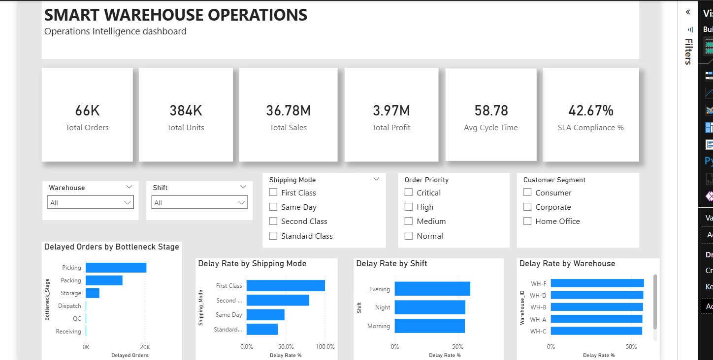
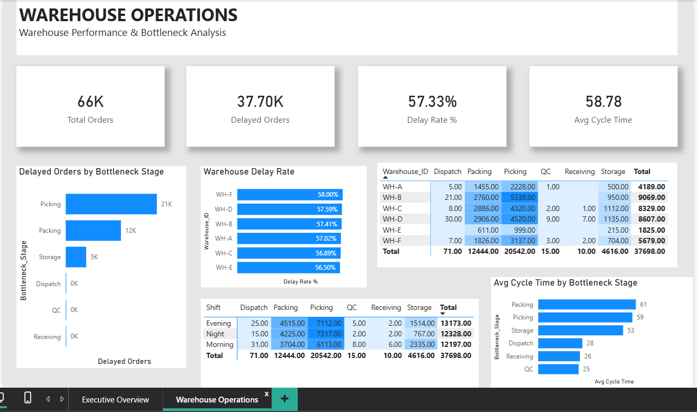

# Smart Warehouse Operations Intelligence System

> **End-to-end Supply Chain & Warehouse Analytics project using SQL Server + Power BI**


---

## 📖 Overview

An operations intelligence solution that analyzes **65K+ warehouse orders**, identifies bottlenecks, measures delivery performance, and supports data-driven warehouse decisions through an interactive Power BI dashboard.

## ✨ Features

- Star-schema data model (`Fact_Orders` + 5 dimension tables)
- 639-line T-SQL analysis script: validation, CTEs, window functions, ranking, delay-rate and contribution analysis
- Two-page interactive Power BI dashboard (Executive Overview, Warehouse Operations)
- Filters for Warehouse, Shift, Shipping Mode, Order Priority and Customer Segment
- Bottleneck diagnosis across Receiving, QC, Storage, Picking, Packing and Dispatch
- Business findings and recommendations

## 📊 Dashboard Preview

### Executive Overview


### Warehouse Operations


---

## 🛠️ Installation & Setup

This is a data-analytics project, so there is no package install. You need:

| Requirement | Used for |
|---|---|
| [Power BI Desktop](https://powerbi.microsoft.com/desktop/) (free, Windows) | Opening the dashboard |
| Microsoft SQL Server + [SSMS](https://learn.microsoft.com/sql/ssms/download-sql-server-management-studio-ssms) (Express edition is free) | Running the SQL analysis |

Clone the repository:

```bash
git clone https://github.com/adityasen15/Smart-Warehouse-Operations-Intelligence-System.git
cd Smart-Warehouse-Operations-Intelligence-System
```

## ▶️ How to Run

**Dashboard**
1. Open `PowerBI/Smart_Warehouse_Operations_Intelligence.pbix` in Power BI Desktop.
2. The dataset is imported inside the file, so no database connection is needed to explore it.
3. Use the filters and switch between the two report pages.

**SQL analysis**
1. Create a SQL Server database named `SmartWarehouseDB` and load the star-schema tables (`Fact_Orders`, `Dim_Date`, `Dim_Geography`, `Dim_Warehouse`, `Dim_Shift`, `Dim_Shipping_Mode`).
2. Open `SQL/warehouse_operations_analysis.sql` in SSMS and run it section by section.

> The raw source data and table-creation scripts are not included in this repository.

---

## 🎯 Business Problem

Warehouse teams need to answer questions such as:

- Which operational stages generate the most delayed orders?
- Which warehouses have the highest delay rates?
- Which shifts experience the most delivery pressure?
- Which shipping modes are most vulnerable to late delivery?
- How do order priority and customer segment relate to delays?
- Where should operations teams focus improvement efforts first?

This project converts order-level operational data into a **star-schema analytical model** and an interactive dashboard for answering these questions.

---

## 🛠️ Technology Stack

| Tool | Purpose |
|---|---|
| **SQL Server / T-SQL** | Data validation, analysis, aggregations, joins and advanced SQL |
| **Power BI** | Interactive dashboard and operational reporting |
| **DAX** | KPI calculations and dashboard measures |
| **Power Query** | Data preparation and transformation |
| **Excel / CSV** | Source-data handling |

---

## 🧩 Data Model — Star Schema

The analytical model follows a **star schema**, with `Fact_Orders` at the center and descriptive dimensions surrounding it.

```text
                    Dim_Date
                       |
Dim_Geography ─── Fact_Orders ─── Dim_Warehouse
                       |
               Dim_Shipping_Mode
                       |
                   Dim_Shift
```

### Fact Table

**`Fact_Orders`** stores the order-level transactional and operational data:

- Order ID and order quantity
- Sales and profit
- Scheduled vs actual shipping days
- SLA status and late-delivery indicator
- Warehouse, geography, shift and shipping-mode keys
- Receiving, QC, storage, picking, packing and dispatch times
- Queue time and total cycle time
- Bottleneck stage
- Order priority and customer segment

### Dimension Tables

- `Dim_Date` — date attributes for time-based analysis
- `Dim_Geography` — regional/geographical attributes
- `Dim_Warehouse` — warehouse identifiers
- `Dim_Shift` — Morning, Evening and Night shifts
- `Dim_Shipping_Mode` — First Class, Second Class, Same Day and Standard Class

---

## 📈 Executive Overview

The first dashboard page provides a management-level view of warehouse performance.

### KPIs

- **65,752** Total Orders
- **384K** Total Units
- **36.78M** Total Sales
- **3.97M** Total Profit
- **58.78** Average Cycle Time
- **42.67%** SLA Compliance

### Interactive Filters

The dashboard supports filtering by:

- Warehouse
- Shift
- Shipping Mode
- Order Priority
- Customer Segment

### Visual Analysis

- Delayed Orders by Bottleneck Stage
- Delay Rate by Shipping Mode
- Delay Rate by Shift
- Delay Rate by Warehouse

---

## 🏭 Warehouse Operations Analysis

The second page focuses on operational performance and bottleneck diagnosis.

It includes:

- Delayed orders by bottleneck stage
- Warehouse-level delay rates
- Warehouse × bottleneck matrix
- Shift × bottleneck matrix
- Average cycle time by bottleneck stage

This page helps move from **"what is happening?"** to **"where should operations intervene?"**

---

## 🔎 Key Findings

### 1. Picking and Packing are the dominant delay drivers

Picking generated **20,542 delayed orders** and Packing generated **12,444**. Together they account for approximately **87.5% of all delayed orders**.

**Business implication:** process improvements in picking and packing are likely to have the largest operational impact.

### 2. Delay is a network-wide problem

Warehouse delay rates are tightly clustered around **56.5%–58.0%** rather than being isolated to one warehouse.

**Business implication:** investigate common process, staffing, capacity and workflow issues instead of treating the problem as a single-warehouse issue.

### 3. Evening shift shows the highest delay rate

The Evening shift has an observed delay rate of approximately **60.08%**, compared with approximately **56.11% for Night** and **55.81% for Morning**.

**Business implication:** evaluate evening workload, staffing levels, queue buildup and handoff processes.

### 4. Shipping mode performance requires investigation

First Class and Second Class show unusually high late-delivery rates in this dataset.

**Important:** this should not automatically be interpreted as a causal effect of shipping mode. SLA definitions, order mix and business rules should be validated before making operational decisions.

---

## 🧮 SQL Analysis

The SQL analysis progresses from basic validation to advanced operational analysis.

### SQL concepts demonstrated

- `SELECT`, `WHERE`, `ORDER BY`
- `GROUP BY` and `HAVING`
- Aggregate functions: `COUNT`, `SUM`, `AVG`, `MIN`, `MAX`
- `CASE WHEN`
- `INNER JOIN`
- Fact-to-dimension analysis
- CTEs
- Window functions
- `ROW_NUMBER()`
- `DENSE_RANK()`
- Delay-rate calculations
- Contribution-to-delay calculations
- Warehouse ranking
- Bottleneck ranking
- Shift analysis
- Shipping-mode analysis
- Customer-segment analysis
- Order-priority analysis
- Regional analysis

The complete SQL script is available here:

➡️ **[View SQL Analysis](SQL/warehouse_operations_analysis.sql)**

---

## 💡 Business Recommendations

1. **Prioritize picking and packing improvements** because these stages account for the overwhelming majority of delayed orders.
2. **Investigate evening-shift operations** through staffing, workload and queue analysis.
3. **Compare warehouses using both volume and delay rate** rather than relying on percentage alone.
4. **Audit First Class and Second Class SLA definitions and order mix** before drawing causal conclusions from their high late rates.
5. Use the dashboard as an operational monitoring layer for identifying where deeper root-cause analysis is required.

---

## 📁 Repository Structure

```text
Smart-Warehouse-Operations-Intelligence-System/
│
├── README.md
│
├── SQL/
│   └── warehouse_operations_analysis.sql
│
├── PowerBI/
│   ├── Smart_Warehouse_Operations_Intelligence.pbix
│   └── README.md
│
└── Screenshots/
    ├── Executive_Overview.png
    ├── Warehouse_Operations.png
    └── README.md
```

---

## 🚀 Project Workflow

```text
Raw Order Data
      ↓
Data Validation & Preparation
      ↓
Star Schema in SQL Server
      ↓
SQL Analysis & KPI Calculations
      ↓
Power BI Data Model
      ↓
Interactive Dashboard
      ↓
Operational Insights & Recommendations
```

---

## 📌 Project Outcome

The project demonstrates how **SQL + dimensional modeling + Power BI** can be combined to turn operational order data into actionable supply-chain insights.

It is designed as a portfolio project for **Data Analytics, Supply Chain Analytics, Business Analytics and Operations Analytics** roles.

---

---

## 🙌 Credits

Original project by **Mahi Jain** (MANIT Bhopal), shared here with her permission.
